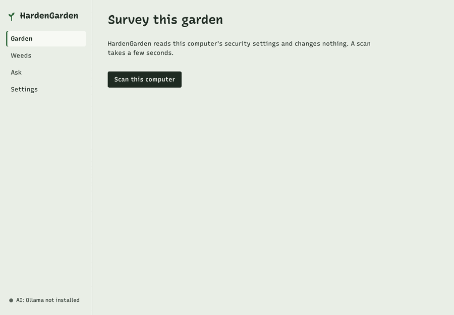
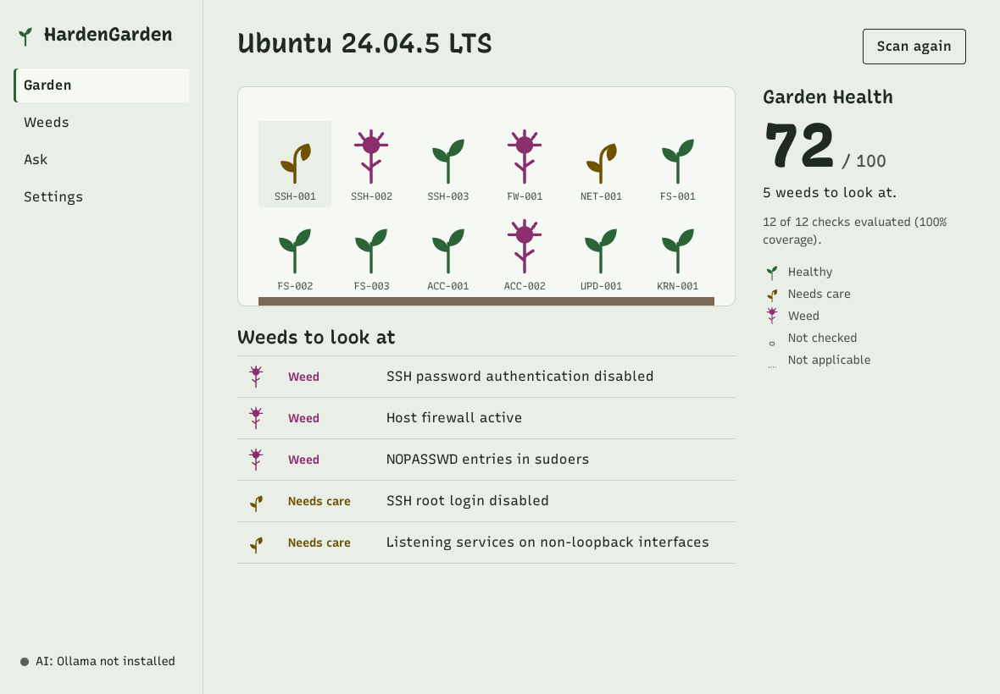
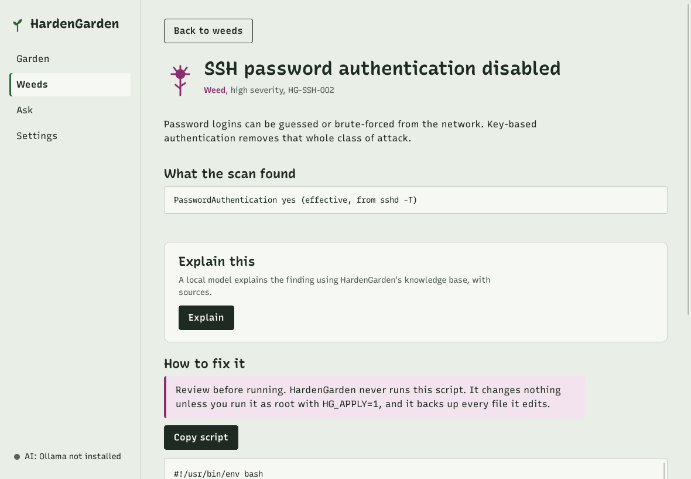
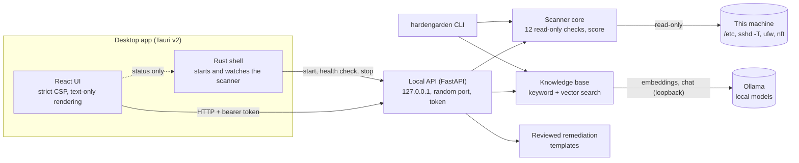

# HardenGarden

[](https://github.com/SaharHalili95/hardengarden/actions/workflows/ci.yml)
[](https://github.com/SaharHalili95/hardengarden/actions/workflows/codeql.yml)
[](https://github.com/SaharHalili95/hardengarden/releases)
[](LICENSE)

**AI-assisted Linux hardening auditor.** *Your system is a garden. HardenGarden finds the weeds.*

> HardenGarden is an educational/portfolio security tool. It is not a certified compliance
> scanner and does not replace a professional audit.



*The real desktop app scanning the machine it was built on (an Ubuntu 24.04 cloud VM, run as
root). Ollama was not installed there, so the AI explanation shows its "not installed" message.*

## What it does

1. **Scans this Linux machine** with 12 read-only checks: SSH, firewall, listening services,
   file permissions, accounts, sudo, automatic updates and ASLR ([full list](docs/CHECKS.md)).
2. **Scores it.** Each finding has a severity and evidence, and the **Garden Health** score
   (0–100) is computed by a fixed formula. No AI is involved in findings or scores.
3. **Explains findings with a local AI model** (Ollama), grounded in an original knowledge
   base with citations. Below a confidence threshold it answers "Not enough information"
   instead of guessing.
4. **Shows a reviewed remediation script** for each finding, which you may read, copy and run
   yourself. HardenGarden never runs it and never changes your system.
5. **Runs as a desktop app** (`.deb`, `.AppImage`) or a **CLI**.

Why: hardening guides are long, and most checkers either print a wall of results or try to
"fix" things for you. HardenGarden shows a few clear weeds, explains them in plain language
with sources, and leaves every change in your hands.

## Install

Releases are on the [Releases page](https://github.com/SaharHalili95/hardengarden/releases).
Every file is signed; see [Verify a download](#verify-a-download).

**Desktop app (Ubuntu 22.04+, Debian 12+).** The `.deb` installs its own dependencies:

<!-- readme-test: skip (downloads a published release; the release workflow installs the same .deb on Ubuntu 22.04, 24.04 and Debian 12) -->
```sh
VERSION=0.1.0
curl -LO "https://github.com/SaharHalili95/hardengarden/releases/download/v${VERSION}/hardengarden_${VERSION}_amd64.deb"
sudo apt install "./hardengarden_${VERSION}_amd64.deb"
hardengarden-desktop        # the app
hardengarden scan           # the .deb also installs the command-line scanner
```

Or the AppImage, which needs nothing installed (FUSE is used if available):

<!-- readme-test: skip (downloads a published release; tested by the release workflow) -->
```sh
VERSION=0.1.0
curl -LO "https://github.com/SaharHalili95/hardengarden/releases/download/v${VERSION}/hardengarden_${VERSION}_x86_64.AppImage"
chmod +x "hardengarden_${VERSION}_x86_64.AppImage"
"./hardengarden_${VERSION}_x86_64.AppImage"
```

**Command line only.** Use this if the desktop package does not work on your system. The CLI
needs Python 3.12; [uv](https://docs.astral.sh/uv/) installs it for you:

<!-- readme-test: skip (downloads a published release; the release workflow installs the same wheel with pipx) -->
```sh
VERSION=0.1.0
uv tool install "https://github.com/SaharHalili95/hardengarden/releases/download/v${VERSION}/hardengarden-${VERSION}-py3-none-any.whl"
# or, where python3.12 exists (Ubuntu 24.04): pipx install --python python3.12 <same URL>
```

**AI explanations (optional).** Install [Ollama](https://ollama.com/download) and start it.
HardenGarden then offers to download a model sized for your RAM. Nothing downloads until you
click **Download** (or run `hardengarden ai pull`). Scanning, scores and scripts work without
Ollama.

## Usage

<!-- readme-test: run -->
```sh
hardengarden scan                        # findings, score and coverage
hardengarden scan --json > report.json   # machine-readable report
hardengarden checks                      # what is checked, and which checks need root
hardengarden remediation HG-SSH-002      # the reviewed fix script (a dry run by default)
hardengarden kb search "why disable root login over ssh"
hardengarden ai status                   # RAM, chosen model tier, Ollama state
```

Some checks read root-only files (sudoers, firewall rules). Without root they are reported as
**Not checked**, the coverage drops, and the app and CLI say so. For full coverage:

<!-- readme-test: skip (needs sudo; scans as root are covered by the remediation container tests) -->
```sh
sudo "$(command -v hardengarden)" scan
```

With Ollama running:

<!-- readme-test: skip (needs Ollama and a downloaded model; the manual llm-eval workflow covers it) -->
```sh
hardengarden ai pull                     # asks before downloading
hardengarden explain HG-SSH-002          # streamed, with [kb:...] citations
hardengarden ask "Is password login over SSH a problem if I use fail2ban?"
```

Remediation scripts change nothing unless you run them as root with `HG_APPLY=1`. They back up
every file they edit, and the SSH scripts check the new configuration with `sshd -t` before
reloading.

| | |
|---|---|
|  |  |

## Architecture



The scanner is the same Python package everywhere: the CLI, the local API, and (frozen with
PyInstaller `--onedir`) the desktop app's background process. Details:
[`docs/ARCHITECTURE.md`](docs/ARCHITECTURE.md).

## Security model

- **Read-only.** Checks only read files through one confined reader (no symlink escapes,
  1 MB limit) and run three allowlisted commands (`sshd -T`, `ufw status`, `nft list ruleset`)
  with fixed arguments, no shell and a timeout.
- **No changes, no privilege escalation.** Remediation is text you copy. The app never asks
  for a password or runs `sudo`.
- **Local only.** The API binds to `127.0.0.1` on a random port and requires a per-launch
  token. The only network traffic goes to your local Ollama. No telemetry, no accounts.
- **Prompt-injection aware.** Text from the scanned system is passed to the model as data,
  model output is rendered as plain text, and links and commands are removed from it. Scores
  never depend on the model.
- **Signed releases.** Checksums, Sigstore signatures, an SPDX SBOM, CodeQL and Trivy.

Threat model: [`docs/THREAT_MODEL.md`](docs/THREAT_MODEL.md). Report vulnerabilities
privately: [`SECURITY.md`](SECURITY.md).

## System requirements

Measured on the build machine (2 vCPU Intel Xeon 2.1 GHz, 7.8 GiB RAM, no GPU, Ubuntu 24.04)
unless marked otherwise.

| | Requirement | Measured |
|---|---|---|
| Distribution | Ubuntu 22.04, Ubuntu 24.04, Debian 12 (x86_64). Others run with platform-specific checks marked Not applicable. | Packages tested in clean Ubuntu 22.04 and 24.04 containers; Debian 12 in CI |
| Scanner only | 1 GB RAM (project minimum) | Scan takes 1.4–1.7 s; peak memory 92 MB |
| Disk | | `.deb` 64 MB download, 225 MiB installed · AppImage 146 MB · CLI with dependencies 369 MB |
| AI, 16 GB RAM or more | `qwen2.5:7b-instruct` | Not measured yet (no Ollama on the build machine) |
| AI, 8–16 GB RAM | `qwen2.5:3b-instruct` | Not measured yet |
| AI, 4–8 GB RAM | `qwen2.5:1.5b-instruct` (reduced quality) | Not measured yet |
| AI, less than 4 GB RAM | AI disabled; everything else works | |

The embedding model (`nomic-embed-text`) is the same in every tier. Model download sizes are
shown in the app before you download.

## Verify a download

<!-- readme-test: skip (needs a published release and cosign) -->
```sh
VERSION=0.1.0
sha256sum -c SHA256SUMS --ignore-missing
cosign verify-blob SHA256SUMS --bundle SHA256SUMS.sigstore.json \
  --certificate-identity "https://github.com/SaharHalili95/hardengarden/.github/workflows/release.yml@refs/tags/v${VERSION}" \
  --certificate-oidc-issuer https://token.actions.githubusercontent.com
```

## Limitations

- **Twelve checks.** This is a focused auditor, not a benchmark implementation. It does not
  implement CIS or STIG and makes no compliance claims.
- **Local machine only.** No remote hosts, no network scanning.
- **x86_64 Linux only**, and the desktop app needs glibc 2.35 or newer.
- **AI answers can be wrong.** They are grounded and cited, but always check the cited
  passage. Findings and scores never depend on them.
- **AI quality and speed are not measured yet** on real models; see the table above.
- **Without root**, firewall and sudoers checks are not checked.
- The local vector store uses chromadb, which has four open advisories in its HTTP server
  mode. HardenGarden never runs that server; see
  [ADR-012](docs/DECISIONS.md#adr-012--open-chromadb-advisories-accepted-as-unreachable).

## Build from source

<!-- readme-test: run -->
```sh
cd backend
uv sync                               # Python 3.12 environment from uv.lock
uv run pytest                         # tests and coverage gates
uv run hardengarden scan
```

Desktop app (needs Node 22, pnpm via corepack, Rust, and the Tauri system libraries listed in
[CONTRIBUTING.md](CONTRIBUTING.md)):

<!-- readme-test: skip (covered by the frontend and desktop-shell CI jobs) -->
```sh
cd desktop
corepack enable
pnpm install --frozen-lockfile
pnpm test && pnpm test:e2e
mkdir -p src-tauri/binaries/hardengarden-sidecar   # filled by release builds
HARDENGARDEN_SIDECAR="$PWD/../backend/.venv/bin/hardengarden" pnpm tauri dev
```

Release packages are built by [`packaging/`](packaging) scripts on Ubuntu 22.04; see
[CONTRIBUTING.md](CONTRIBUTING.md#releases).

## Roadmap

- Measure AI answer quality and speed on real hardware for every tier, and publish the numbers.
- Replace or isolate chromadb so its server-mode advisories no longer apply (ADR-012).
- More checks: auditd and journald logging, kernel module blacklists, mount options.
- arm64 packages.
- A packaged Debian/Ubuntu repository for updates through `apt`.

## License

[Apache-2.0](LICENSE). Knowledge-base documents are original writing; their references are
listed in each document.
