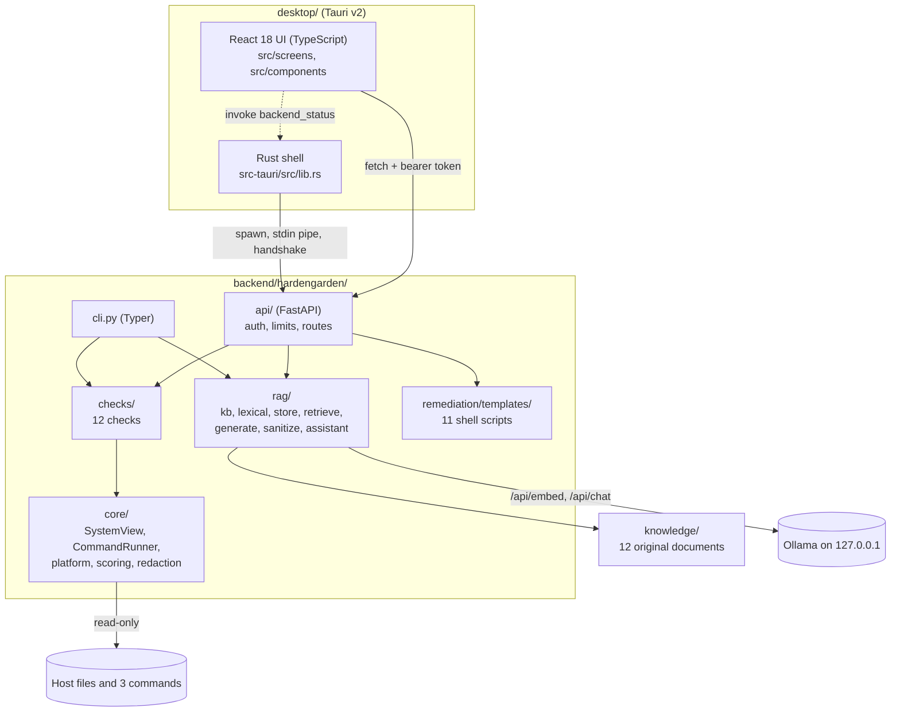
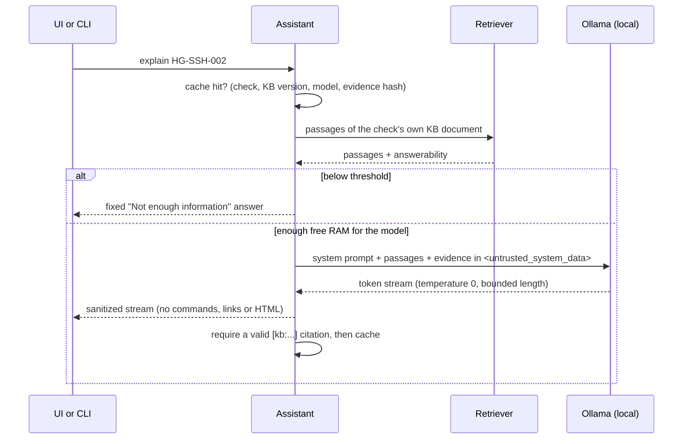

# Architecture

HardenGarden has one scanner, written in Python, and three ways to use it: the CLI, a local
API, and a desktop app that runs the API in the background. Design decisions and their
reasons are in [`DECISIONS.md`](DECISIONS.md); threats and mitigations are in
[`THREAT_MODEL.md`](THREAT_MODEL.md).

## Components

| Part | Responsibility | Key files |
|---|---|---|
| `core/systemview.py` | The only way checks read files: a configurable root, no symlink escapes, 1 MB cap | R6 |
| `core/runner.py` | Runs one of three commands, chosen from an enum, with fixed argv, no shell, 10 s timeout; binaries must be root-owned | R4, ADR-008 |
| `checks/` | One module per category; each check is a pure function of (SystemView, CommandRunner, Platform) and returns a `CheckResult` | §5.1 |
| `core/engine.py`, `core/scoring.py` | Runs every check (a crashing check becomes ERROR), computes the Garden Health score and coverage | §5.2, R11 |
| `core/redaction.py` | Minimizes and redacts evidence before it is shown, logged or sent to a model | R9 |
| `rag/` | Knowledge base, BM25 + vector retrieval, answerability threshold, grounded generation, output sanitizer, explanation cache, model tiers | ADR-011, ADR-013, ADR-015 |
| `remediation/` | Renders a reviewed template with a header; never executes it | R2, R12, ADR-014 |
| `api/` | Loopback-only HTTP API with a per-launch token, Host check, size and rate limits, redacted logs | R8, ADR-017 |
| `desktop/src-tauri` | Starts the scanner, waits for its health check, reports failures (R35), stops it on exit | ADR-019 |
| `desktop/src` | Screens; renders model output as plain text only | ADR-020 |
| `packaging/` | Freezes the scanner, builds `.deb` and AppImage, release checks and smoke tests | ADR-021 |

## A scan

1. `platform.py` reads `os-release` and decides which checks apply; on an unsupported distro,
   platform-specific checks are `NOT_APPLICABLE` and a notice is shown.
2. Each check reads files through `SystemView` (default root `/`, or `--root PATH` to scan a
   mounted image) and, on the live host only, may run `sshd -T`, `ufw status` or
   `nft list ruleset`. Checks that need root are `SKIPPED` with `insufficient_privileges`
   when not root; the CLI and app then say "Run with sudo for full coverage".
3. Results carry at most 10 evidence lines, already minimized and redacted.
4. The score is `100 × (1 − (Σ FAIL weights + ½ Σ WARN weights) ÷ Σ applicable weights)`
   with weights 10/6/3/1/0 by severity. SKIPPED, ERROR and NOT_APPLICABLE are excluded and
   reported as coverage. No applicable checks means "Not enough data", never 100.

## An explanation

- **Retrieval** ranks with BM25 (standard library) and, when embeddings exist, fuses vector
  similarity by reciprocal rank fusion. Answerability is computed from the question's terms,
  so refusals are deterministic with or without Ollama.
- **Generation** has a hard timeout (default 120 s) enforced by a watchdog and a Cancel that
  closes the socket from any thread. Free memory is checked before every generation.
- **Model tiers** are chosen from the machine's total RAM: 7B at 16 GB or more, 3B at 8–16 GB, 1.5B at
  4–8 GB, disabled below 4 GB. The embedding model is the same in all tiers.

## The desktop app

1. The Rust shell starts `sidecar/hardengarden-sidecar serve --watch-stdin` (fixed path and
   arguments) from the app's resources.
2. The scanner binds `127.0.0.1:0`, creates a 32-byte token, and prints one line:
   `{"event":"ready","port":N,"token":"..."}`. The token never touches disk or logs.
3. The shell polls `GET /health` on that port. Within 15 s it reports `Ready` (port and
   token) or `Failed` with a reason and the scanner's last 40 log lines.
4. The UI asks the shell for that status (`backend_status`, its only command) and then talks
   to the API directly with the token. On failure it shows the error screen with the CLI
   fallback instead of a blank window.
5. On exit the shell closes the scanner's stdin; the scanner exits on end-of-file, so it also
   stops if the app is killed.

The webview has one Tauri permission, `clipboard-manager:allow-write-text`. It cannot start
processes, read files or make requests outside `127.0.0.1` (CSP `connect-src`).

## Data on disk

| What | Where | Permissions |
|---|---|---|
| Settings (Ollama URL, model, threshold) | `$XDG_DATA_HOME/hardengarden/settings.json` | directory 0700 |
| Vector store, ingested man pages | `$XDG_DATA_HOME/hardengarden/` | 0700 / 0600 |
| Explanation cache | `$XDG_CACHE_HOME/hardengarden/` | 0700 / 0600 |
| Scan results | memory only (the API keeps the last 20 scans until it exits) | |

Nothing is written outside the user's own directories, and nothing is sent anywhere except
the local Ollama endpoint.

## Packaging

- The scanner is frozen with PyInstaller `--onedir` (never `--onefile`, which would execute
  from `/tmp` and fail where `/tmp` is `noexec`).
- Everything native is built on Ubuntu 22.04 (glibc 2.35) and checked with `objdump`.
- The same scanner folder goes into the `.deb` (`/usr/lib/HardenGarden/sidecar/`) and the
  AppImage. The CLI is also a pure-Python wheel for `pipx`/`uv tool`.

## Testing

| Layer | How |
|---|---|
| Checks | Fixture filesystems per scenario (`hardened`, `default_ubuntu_2404`, `misconfigured`, `edge_cases`); PASS, FAIL and edge cases for every check |
| Safety | AST test for forbidden patterns (R5), ruff `S` rules and bandit; a write-blocking audit hook proves scans are read-only; symlink-escape tests |
| Remediation | shellcheck and snapshots; every template run in a disposable Ubuntu 24.04 container, then re-scanned, and SSH must still start |
| RAG | Golden and hold-out question sets (Recall@5, negative rejection); grounding, refusal, injection, timeout, cancel and cache tests against a fake Ollama over real HTTP |
| API | Auth on every route, CORS, Host, 413, 429, redaction, OpenAPI snapshot |
| Desktop | Vitest for every screen and AI state; Playwright E2E on the production build with axe in light and dark mode; Rust unit tests |
| Release | glibc check; `.deb`, `pipx`, desktop app and AppImage tested in clean Ubuntu 22.04, 24.04 and Debian 12 containers, including a broken scanner and `noexec /tmp` |
